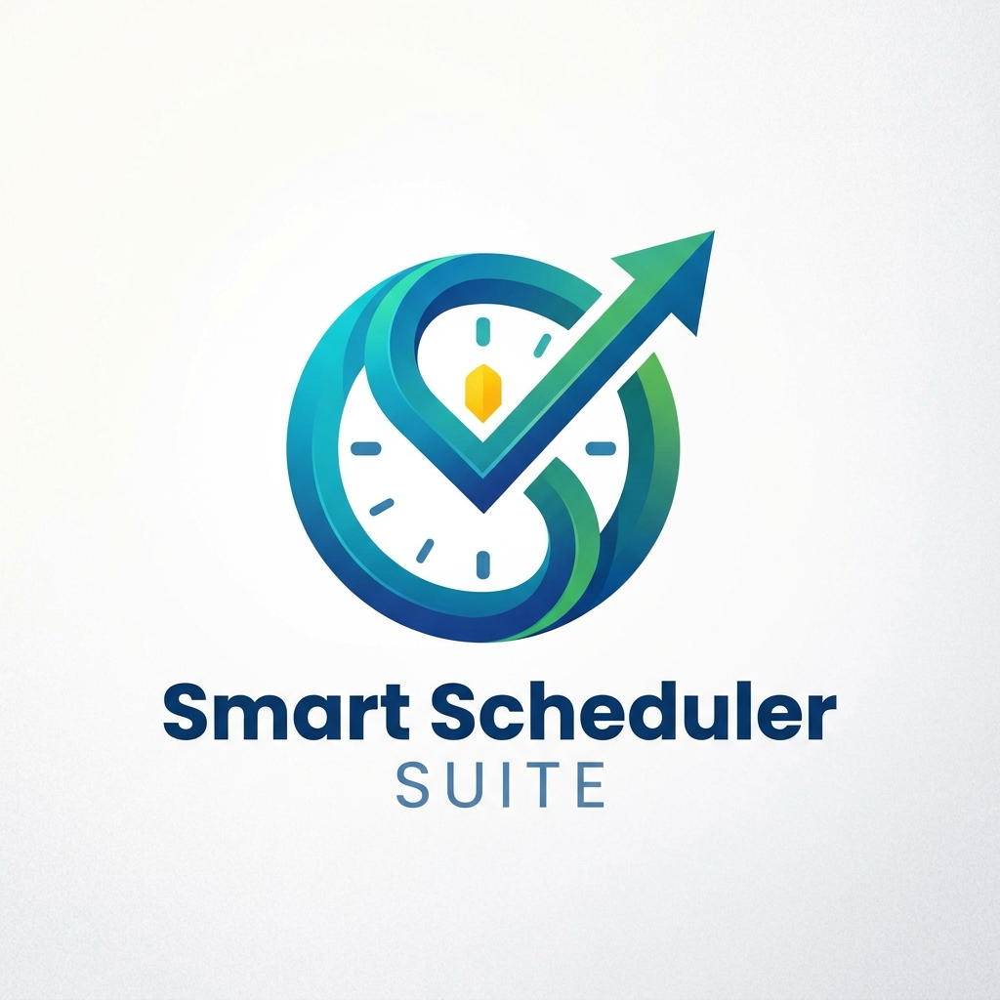

<div align="center">



# Smart Scheduler Suite

### Plan your classes, events, exams and tournaments, all in one desktop app.

*Built from scratch in C++ and Qt 6 with our own data structures, with no STL containers in the engine.*

[](https://github.com/MDAhmed115/Smart-Schedular-Suite/releases/download/v1.0.0/SmartSchedulerSuite-v1.0.0-win64.zip)


</div>

---

## Why Smart Scheduler?

University life is a puzzle: clashing classes, surprise events, back-to-back exams, society tournaments.
**Smart Scheduler Suite** solves all four puzzles in one clean, black-and-white, no-nonsense interface, and it **runs without installing anything**.

## Features

### Timetable Generator
- Define courses, slots per class and classes per week.
- Generates a **clash-free** weekly timetable using backtracking.
- Optional **random long breaks**, so every day gets its own shape.
- Reserve day support, custom slot and break lengths.

### Event Planner
- **University mode**: fits events into the free time around your classes and reports exactly which classes an event overlaps.
- **External mode**: an independent weekly grid for parties, meetups and functions.
- Quick add (`Workshop 1h30, Club meeting 45`), custom exact times, and daily/weekly/monthly repeats.
- Week-by-week navigation.

### Tournament Planner
- **Round robin + semi-finals + final** (single or double legs).
- **FIFA 2026-style**: groups, then Round of 32, R16, QF, SF and Final.
- **Direct knockout** with automatic byes.
- Live standings, an auto-drawn bracket, penalty shoot-outs, and "simulate all remaining".

### Study Planner
- Enter exam dates, times and difficulty.
- Reads your timetable and events, then builds a **day-by-day study plan** with focus blocks, breaks, meals and rest days.
- Harder subjects and nearer exams get more time.
- Exam days are handled properly: study before and after, never during.

### Export Everything
**PDF · JPG · CSV · ICS (calendar) · JSON**

---

## Download and run (no installation, no compiling)

1. Go to the [**Releases**](https://github.com/YOUR_USERNAME/YOUR_REPO/releases/latest) page.
2. Download `SmartSchedulerSuite-vX.X.X-win64.zip`.
3. **Extract** the ZIP (don't run it from inside the archive).
4. Double-click **`SmartSchedulerSuite.exe`**.

Sample files are included in the `data/` folder. Use *Load teams (CSV)* in the Tournament tab to try them.

---

## Data Structures and Algorithms

This is a Data Structures project, so the engine uses **our own implementations**:

| Structure / Algorithm | Where it is used |
|---|---|
| `DynArray` | Core container across all modules |
| `LinkedList` | Hash table buckets, course sections |
| `Stack` | Backtracking state in the timetable solver |
| `Queue` | Kahn's topological sort, level-order traversal |
| `MinHeap` | Keeping the Top-K best timetables |
| `HashTable` | ID lookup, duplicate detection |
| `Graph` | Section conflict graph, task dependency graph |
| `BST` / `BinaryTree` | Tree utilities and traversals |
| Merge / Quick / Insertion / Shell / Bubble / Selection sort | Standings, scheduling, ranking |
| **Backtracking** | Clash-free timetable generation |
| **Topological sort (Kahn)** | Task dependency ordering |
| **Circle method** | Round-robin fixture generation |
| **Seeded single-elimination bracket** | Knockout draws with byes |

---

## Build from source

**Requirements:** Windows 10/11, Qt 6 (MSVC 64-bit kit), CMake 3.16+, Visual Studio with the "Desktop development with C++" workload.

```bat
git clone https://github.com/YOUR_USERNAME/YOUR_REPO.git
cd YOUR_REPO

:: configure (adjust the Qt path to your install)
cmake -S . -B build -DCMAKE_PREFIX_PATH="C:/Qt/6.7.2/msvc2022_64"

:: build (edit the vcvars64.bat path inside build.bat if your Visual Studio is elsewhere)
build.bat
```

**Create a portable package:** run `deploy.bat`. It builds in Release mode, bundles all Qt and runtime DLLs, and writes a ready-to-share ZIP to `dist/`.

---

## Project structure

```
├── core/        # Custom data structures, algorithms, models
├── engine/      # Scheduler, planners, solver, tournament engine (Qt-free)
├── gui/         # Qt Widgets interface
├── data/        # Sample CSV files
├── assets/      # Icons and logo
└── deploy.bat   # One-click packaging script
```

The `engine/` layer has **zero Qt dependency**, so the logic is fully separate from the UI.

---

## Team

Built by students of **FAST-NUCES Karachi** for the Data Structures course (CS-2001).

| Name | GitHub |
|---|---|
| Muhammed Ahmed Ashfaq | [@MDAhmed-115](https://github.com/MDAhmed-115) |
| Fahad-ul-Islam | [@username](https://github.com/username) |
| Moazamuddin | [@Moazamuddin12](https://github.com/Moazamuddin12) |

---

<div align="center">

If this helped you survive your semester, **give it a star** ⭐

</div>
